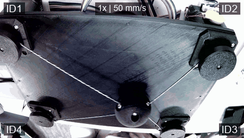
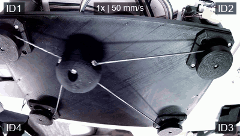
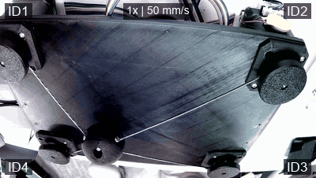
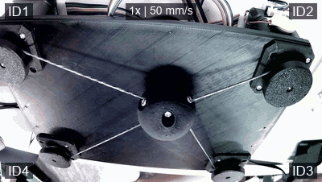

# 绳驱按摩 / 绘画平台

这是一个四电机绳驱二维平台。仓库同时包含两种控制方式：ESP32-S3 主控的手机热点网页，以及电脑通过 USB-RS485 直连 Y42 电机的本地调试网页。电脑直连模式不需要 ESP32 控制板，适合电机 ID、固件模式、几何校准和轨迹控制调试。

最近更新、目录入口和验证结果见 [2026-09-08 版本说明](docs/20260908_版本更新.md)。

## 实机效果

以下为真实相机录像截取的原速动图，绘制速度 **50mm/s**，范围 **88×118.4mm**。展示画面旋转180°后：**左上ID1、右上ID2、右下ID3、左下ID4**。原相机视角对应右下1、左下2、左上3、右上4；旋转仅用于展示，不改变电机配置或控制坐标。

| 连续测试片段 A | 连续测试片段 B |
| --- | --- |
|  |  |
| 连续测试片段 C | “星猫”笔画运动片段 |
|  |  |

动图为8秒片段循环，经过缩小和降帧压缩，合计约6.8MB；回到开头是动图循环，不是设备突然回跳。小球按字形运动，笔间移动不算笔画；动图不是光学精度或张力测量。完整视频仅保存在本地，不纳入仓库，截取信息见 [素材记录](docs/media/capture-provenance.json)。

## 当前能力

- 电脑直连模式按最新 STEP/角点图固定为小球中心工作区 110 × 148 mm，中心 `(55,74)`；四个卷轴轴心组成 198 × 148 mm 框，M1～M4 坐标为 `(-44,148)`、`(154,148)`、`(154,0)`、`(-44,0)`。当前光滑卷筒乱层和球端姿态尚未机械确定化，绝对运动仍由连接、编号、方向、校准和急停安全门控制。
- ESP32 开机创建无密码热点，手机连接后可进入网页控制。
- 电脑可通过 USB-RS485 直接打开本地调试网页，不需要手机连接热点或 ESP32。
- Windows 图片转轨迹工具支持常见图片格式，本地快速生成轨迹预览、TXT、JSON、PNG，并可通过 WiFi 或 USB 上传到板子。
- 电机校准参数、绘制速度、轨迹间移动速度、电机运动电流等参数保存到 ESP32 NVS，重启后继续使用。
- 气压部分保留手动控制：充气、慢放气、快放气、停止，并实时显示传感器电压/换算压力。

## 电脑直连 Y42（USB-RS485）

### 适用范围

电脑直连工具直接发送 Y42 二进制 RS485 指令，默认按 X 固件协议工作。它不复用 ESP32 的文本协议，也不会控制 ESP32 GPIO，因此气泵、阀门和 GPIO 输出仍只能由 ESP32 控制。

固定电机映射如下：

| 电机 | 位置 | ID |
| --- | --- | --- |
| M1 | 左上 | 1 |
| M2 | 右上 | 2 |
| M3 | 右下 | 3 |
| M4 | 左下 | 4 |

### 硬件连接

1. USB-RS485 转换器 A/B 接到四台 Y42 的 RS485 总线，电脑端安装好转换器驱动。
2. 总线上每台电机必须有唯一 ID；改 ID 时建议只接目标电机，避免多台一起改名。
3. 电机上电后应处于 X 固件模式（绿灯闪烁）。固件切换是驱动器参数切换，不是刷写应用固件；切换后按页面提示断电重启。
4. 首次运动前确认绳路、小球、滑轮和机械限位安全，并准备硬件急停。网页的空格键也会发送四台急停并失能。

### 安装依赖

```powershell
python -m pip install pyserial
```

### 命令行工具

列出电脑上的串口：

```powershell
.\run_y42_pc_direct.bat ports
```

扫描未知 ID（默认 1–255，只读，不发送运动指令）：

```powershell
.\run_y42_pc_direct.bat scan --port COM7 --start 1 --end 20
```

读取单台状态：

```powershell
.\run_y42_pc_direct.bat status --port COM7 --id 1
```

修改 ID 前必须保证旧 ID 只对应目标电机。改完后断电重启，再重新扫描：

```powershell
.\run_y42_pc_direct.bat set-id --port COM7 --old 1 --new 5
```

单电机低速位置测试（X 固件相对位置模式）：

```powershell
.\run_y42_pc_direct.bat position --port COM7 --id 1 --degrees 5 --direction 0
.\run_y42_pc_direct.bat stop --port COM7 --id 1
.\run_y42_pc_direct.bat disable --port COM7 --id 1
```

运动、力矩和原始帧命令会要求确认；自动化测试可显式追加 `--yes`。不要在不确认机构安全时使用 `--yes`。

### 本地网页调试台：真实新手五步

电脑直连实机当前按 **4 台 Y42 电机、COM5、921600 波特率**操作。`/onboarding` 是真实操作页，五步按钮直接调用当前主控接口；运动前仍必须确认现场安全，网页急停和硬件急停优先。

启动并打开页面：

```powershell
.\run_y42_pc_web.bat
```

- 完整调试台：<http://127.0.0.1:8787/>
- 实机新手向导：<http://127.0.0.1:8787/onboarding>

按页面的五步完成首次操作：

1. **连接。** 点击“连接”，页面先使能控制安全门，再读取四台状态；顶部应显示 `4/4 在线`。出厂或新电机若默认共用同一个 ID，不要四台一起写入，先进入下一步逐台接入。
2. **编号。** 其他三台断开时，一次只接一台，扫描当前 ID 和目标 ID 是否空闲，再写入唯一编号。页面中的实机教学记录是 M4：`4 → 5`，扫描确认后写入，软重启并回读成功，再恢复 `5 → 4` 并回读；新电机也按同一顺序操作。每次写入后必须回读成功，不能把四台共用 ID 当成已区分。
3. **方向。** 选择 M1～M4，每台执行一次 **45°** 方向测试，观察卷盘实际收绳方向；方向正确就保存，方向相反就切换后再次测试。四台正反测试完成后，恢复最终收绳配置。测试会运动，确认机构无人接触并随时可急停。
4. **校准。** 四台方向确认后点击一次“校准”，等待四角流程完成。当前实机流程使用 **1500mA 强拉 / 300mA 保持**；校准会运动到四个角点，未完成前不要绘制。
5. **绘制。** 可先点击“一键六图案”，或载入 **“星猫”20 笔**后点击绘制。当前新手参数是 **50mm/s**，路径范围约为工作区的 **80%：88 × 118.4mm**；页面显示目标笔画和已发送目标，笔间移动不计为笔画，不加曲线平滑，实机效果以相机观察为准。六图案为：**直线、圆形、矩形、三角形、十字、蛇形**。

本轮实机记录包括：M4 `4→5→4` 编号软重启回读、四台正反方向测试后恢复、1500/300mA 四角校准、六图案，以及“星猫”20 笔绘制。它们是当前记录，不代表所有机构状态都已永久验收；重新接线、换绳或异常松绳后仍应重新检查。

仓库通过上方动图展示效果。完整横屏教程、六图案及“星猫”原速录像仅保留于本机 `qa/tutorial_landscape/real_lesson_20260908/`，不上传至仓库。

运动中点击网页“急停”或使用硬件急停；停止后先确认四台失能，再处理线缆、电源或校准提示。

### 几何参数和过程数据

主调试台提前显示 **88 × 118.4 mm** 的可绘制边框，框内手绘坐标直接发送，不在画完后再次缩放。绿色线是已发送目标的进度高亮，不是相机测量。速度修改在下次绘制生效；短线和尖角受加减速约束，因此设定速度翻倍不代表整段耗时减半。

设备标定与串口配置在本机运行时生成，不随仓库分发。首次使用请完成编号、方向检查和四角校准，不要复制其他设备的编码器零点。历次 `docs/202609*.md` 是调试历史，当前行为以本 README 和代码为准。

- `tools/y42_pc_calibration.json`（本机生成，Git 忽略）：实机模型与持久化张紧点；固定硬件模型为球心工作区 110×148mm、电机轴框 198×148mm、卷筒横向参考偏移 12.5mm、球径 40mm、球端连接点跨距 30.534×22.823mm，并明确记录光滑卷筒的排线/叠层仍不可观。
- `tools/y42_pc_process_log.jsonl`：运行时产生的轨迹、每批四电机绝对位置/相电流、归一化绳长、频率和错误过程数据，默认不提交到 GitHub；采用紧凑 JSONL 逐条追加，进程不把全量数据留在内存。
- 外部样本输入示例（可选）：`[{"xy_mm":[20,20],"yaw_deg":0,"positions_deg":[...]}]`；若使用该入口，`positions_deg` 必须与相机/量具读到的同一时刻一致，不能填 `position_to_xyz()` 反算结果。
- 每次校准/运行记录 `model_family_key` 和校准截距参考；`relative_rope_lengths_mm` 去除了本次校准的绝对零点偏移，适合跨校准批次比较绳路模型。绝对角度仍原样保留，便于追查编码器和通信故障。
- `docs/问题逐项验收表.md`：按你提出的问题逐条列出修改、协议/代码依据、离线验证结果和仍需上电实测的项目。
- 重新做四角校准会覆盖校准结果；校准前不需要重复做单台编码器校准。

#### 当前绘制控制

当前实机绘制采用 **四轴纯位置控制**：四台电机通过 `0xAA` 合帧按 **100Hz** 发送绝对位置目标，运动电流上限为 **2000mA**，`nofeedback` 模式不以反馈回读门控下一目标。页面上的绿色线表示已发送目标，真实效果以相机和主控过程日志为准。

旧的 3+1、张力跟踪和相机反解方案只作为历史设计资料保留，不能当作当前 `/onboarding` 绘制流程的控制架构。卷筒排线、叠层和绳路状态变化仍需在每次异常后人工检查。

### 故障排查

| 现象 | 检查方式 |
| --- | --- |
| 找不到串口 | 重新插拔 USB-RS485，关闭串口监视器，点击网页“刷新串口” |
| 电机 ID 不全 | 单台接入扫描，确认每台 ID 唯一，再断电重启 |
| 不是 X 固件 | 读取固件状态，按页面执行切换并断电重启，确认绿灯闪烁 |
| 轨迹未完成 | 先点击网页急停，确认四台失能，再检查绳路、供电和校准状态；不要直接重复发送绘制请求 |
| 星猫路径未载入 | 回到绘制步骤点击“载入「星猫」”，确认画布出现蓝色目标笔画后再点击绘制 |
| 运动中离线 | 先按空格或硬件急停，再检查 A/B、供电、终端电阻和转换器驱动；不要让电机在未确认状态下持续使能 |

电脑直连模式不负责气泵、阀门或 ESP32 GPIO 控制；需要这些功能时请使用 ESP32 主控网页。

## 硬件连接

### 主控和电机

下面的 GPIO 接线和旧系数只适用于 ESP32 主控示例；电脑直连网页不使用这些 GPIO。

- 开发板：ESP32-S3 N16R8。
- TTL 转 485 模块：
  - ESP32 GPIO17 -> 485 TX/RX 模块输入侧 TX
  - ESP32 GPIO16 -> 485 TX/RX 模块输入侧 RX
  - GND 共地
- 电机摆放方向：
- M1：左上，PC 球心坐标 `(-44,148)`
- M2：右上，PC 球心坐标 `(154,148)`
- M3：右下，PC 球心坐标 `(154,0)`
- M4：左下，PC 球心坐标 `(-44,0)`

电脑直连网页把 110 × 148 mm 用户球心行程和 198 × 148 mm 卷轴轴心框分开：

| 电机 | PC 物理锚点坐标 |
| --- | --- |
| M1 左上 | `(-44, 148)` |
| M2 右上 | `(154, 148)` |
| M3 右下 | `(154, 0)` |
| M4 左下 | `(-44, 0)` |

ESP32 固件示例默认校准系数为：

```text
M1: -3.761 deg/mm
M2:  3.775 deg/mm
M3: -3.742 deg/mm
M4:  3.796 deg/mm
```

当前本机原始四角数据已按 150 × 150 mm 物理锚点重拟合，用户工作区仍为 110 × 148 mm：

```text
M1: -4.8467 deg/mm (R² 0.9738)
M2:  4.9080 deg/mm (R² 0.9724)
M3: -4.8256 deg/mm (R² 0.9711)
M4:  4.8924 deg/mm (R² 0.9666)
```

### 气压控制

当前代码按下面接线工作：

```text
GPIO11: 充气泵 PWM
GPIO9 : 放气阀
GPIO10: 快速放气辅助阀
GPIO4 : 模拟气压传感器输出
```

手动控制逻辑：

- 充气：GPIO11 输出 PWM。
- 慢放气：GPIO9 打开。
- 快放气：GPIO9 + GPIO10 同时打开。
- 保压/停止：三个输出全部关闭。

当前传感器按 3.3 V 供电、模拟输出计算，适配已测试的 CFSensor/XGZP6847A 类 -5~5 kPa 气压模块。网页端先直接显示电压值，方便继续标定。

## 环境准备

安装 Python 3.10+，然后安装 PlatformIO：

```powershell
python -m pip install -U platformio
```

烧录固件：

```powershell
python -m platformio run --target upload --upload-port COM52
```

串口监视：

```powershell
python -m platformio device monitor --port COM52 --baud 460800
```

如果你的板子不是 COM52，把命令里的端口改成设备管理器里显示的 `USB-Enhanced-SERIAL CH343` 对应端口。

## 手机热点控制

烧录后 ESP32 会创建热点：

```text
SSID: MassageDraw
密码: 无
地址: http://192.168.4.1/
```

手机连接热点后通常会自动跳转。如果没有跳转，手动打开 `http://192.168.4.1/`。

网页端可以：

- 在白色画布里手绘轨迹。
- 导入/上传轨迹。
- 开始、停止、清空画布、循环开关。
- 调节绘制速度、轨迹间移动速度、电机运动电流。
- 一键校准参数并显示校准系数。
- 手动充气、慢放气、快放气、停止气压输出。

## USB 调试网页

电脑插上开发板后运行：

```powershell
.\run_usb_debug_web.bat
```

浏览器会打开：

```text
http://127.0.0.1:8765/
```

这个页面通过 Web Serial/本地 Python 服务和 ESP32 通信，适合调试时不用手机热点。使用前请关闭 PlatformIO Monitor、Arduino 串口监视器等占用 COM 口的软件。

USB 调试网页包含：

- 串口自动搜索和端口选择。
- 当前气压电压、换算压力、控制状态显示。
- 手动充气、慢放气、快放气、停止，以及气泵 PWM 调节。
- TXT/JSON 轨迹上传。
- 开始绘制、停止、清空画板。
- 校准参数、读取状态。
- 轨迹速度滑块。
- 电机运动电流滑块。

## 图片转轨迹工具

运行：

```powershell
.\run_trajectory_studio.bat
```

首次运行会自动安装：

```text
opencv-python
numpy
pyserial
```

工具功能：

- 打开图片后自动转换，原图在上、轨迹预览在下，方便对比。
- 支持 JPG、PNG、BMP、WebP 等 OpenCV 可读取的常用图片格式。
- 支持多种模式，例如惊喜复刻、整图素描、照片主体线稿、深色线稿、边缘线稿等。
- 可导出轨迹 TXT、JSON 和预览 PNG。
- 可直接通过 WiFi 上传到 ESP32 热点网页。
- 可直接通过 USB 上传到开发板。

轨迹会被缩放到 110 x 148 mm 小球中心绘图区域内，输出点坐标单位为 mm。

## 轨迹文件格式

TXT 格式是一行一段轨迹：

```text
x1,y1;x2,y2;x3,y3
x1,y1;x2,y2;x3,y3
```

JSON 格式是多段轨迹数组：

```json
[
  [{"x": 10.0, "y": 20.0}, {"x": 11.0, "y": 20.5}],
  [{"x": 30.0, "y": 40.0}, {"x": 31.0, "y": 41.0}]
]
```

## 常用串口命令

```text
usbstatus                读取完整状态
current 2000             设置并保存绘图运动电流，单位 mA（用户可调上限）
speed 40                 设置绘制速度百分比
travelspeed 40           设置轨迹间移动速度百分比
tension 2.0              设置绳子预拉紧补偿，单位 mm
coef                     查看当前电机系数
coef set M1 M2 M3 M4     手动写入并保存四个电机系数
calibrate                开始自动校准
webstart                 开始绘制
webstop                  停止绘制
loopon / loopoff         开启/关闭循环
clearpath                清空板端轨迹
goto X Y                 移动到指定坐标
airbits 4 0 180          持续充气，PWM=180
airbits 1 0 0            持续慢放气
airbits 3 0 0            持续快放气
airbits 0 0 0            停止气压输出
airstatus                读取气压状态
```

## 打包 Windows EXE

GitHub 仓库建议只放源码，不提交 exe、`dist/`、`build/`、`.pio/`。

如果要给别人一键运行的 Windows 程序，执行：

```powershell
.\build_trajectory_studio_exe.bat
```

生成结果：

```text
dist\TrajectoryStudio.exe
```

把这个 exe 上传到 GitHub Releases 的附件里，不要提交进 Git 历史。

## GitHub 更新前检查

```powershell
git status --short
python -m platformio run
```

确认没有多余的未追踪文件，再提交：

```powershell
git add README.md .gitignore platformio.ini src tools run_*.bat build_trajectory_studio_exe.bat
git commit -m "Add USB trajectory upload and air/manual control tools"
git push
```
